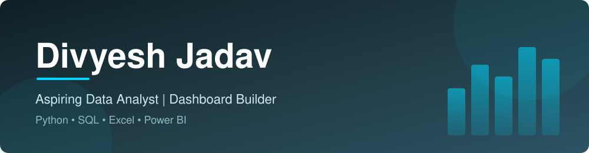

<!-- ======================= BANNER ======================= -->
<p align="center">
  
</p>

<p align="center">
  
</p>

<p align="center">
  
  
  
</p>

<br>

<!-- ======================= ABOUT ======================= -->
<h2 align="center">✨ About Me ✨</h2>

<table align="center">
<tr>
<td>

```yaml
name:        Divyesh Jadav
role:        Aspiring Data Analyst & AI Engineer
location:    Surat, India 🇮🇳
focus:       Dashboards, Data Cleaning, Business Insights
learning:    Advanced SQL, Python for Data Analysis
building:    Real-world company dashboards
goal:        Turn data into decisions that matter
fun_fact:    I love making boring numbers look beautiful 😄
```

</td>
</tr>
</table>

<br>

<!-- ======================= SKILLS ======================= -->
<h2 align="center">🛠️ Tech Stack</h2>

<p align="center">
  
</p>

<p align="center">
  
  
  
  
  
</p>

<br>

<!-- ======================= PROJECTS ======================= -->
<h2 align="center">🚀 Featured Projects</h2>

<p align="center">
  <a href="https://github.com/iamdivyeshjadav/Myntra_Sales_Dashboard">
    
  </a>
  <a href="https://github.com/iamdivyeshjadav/HDFC_Dashboard">
    
  </a>
</p>
<p align="center">
  <a href="https://github.com/iamdivyeshjadav/Accenture_Dashboard">
    
  </a>
  <a href="https://github.com/iamdivyeshjadav/Asianpaints_Dashboard">
    
  </a>
</p>
<p align="center">
  <a href="https://github.com/iamdivyeshjadav/Student_Performance_Dashboard">
    
  </a>
  <a href="https://github.com/iamdivyeshjadav/superstore_dashboard">
    
  </a>
</p>

<details>
<summary><b>📂 Click to see more projects & practice work</b></summary>
<br>

| Area | Repositories |
|------|--------------|
| 🐍 **Python** | [Project.PY](https://github.com/iamdivyeshjadav/Project.PY) · [Practice.PY](https://github.com/iamdivyeshjadav/Practice.PY) |
| 🗄️ **SQL** | [Project.sql](https://github.com/iamdivyeshjadav/Project.sql) |
| 📗 **Excel** | [Project.Excel](https://github.com/iamdivyeshjadav/Project.Excel) · [Practice.Excel](https://github.com/iamdivyeshjadav/Practice.Excel) |
| ⚙️ **C Programming** | [Project.C](https://github.com/iamdivyeshjadav/Project.C) · [Practice.C](https://github.com/iamdivyeshjadav/Practice.C) |

</details>

<br>

<!-- ======================= STATS ======================= -->
<h2
